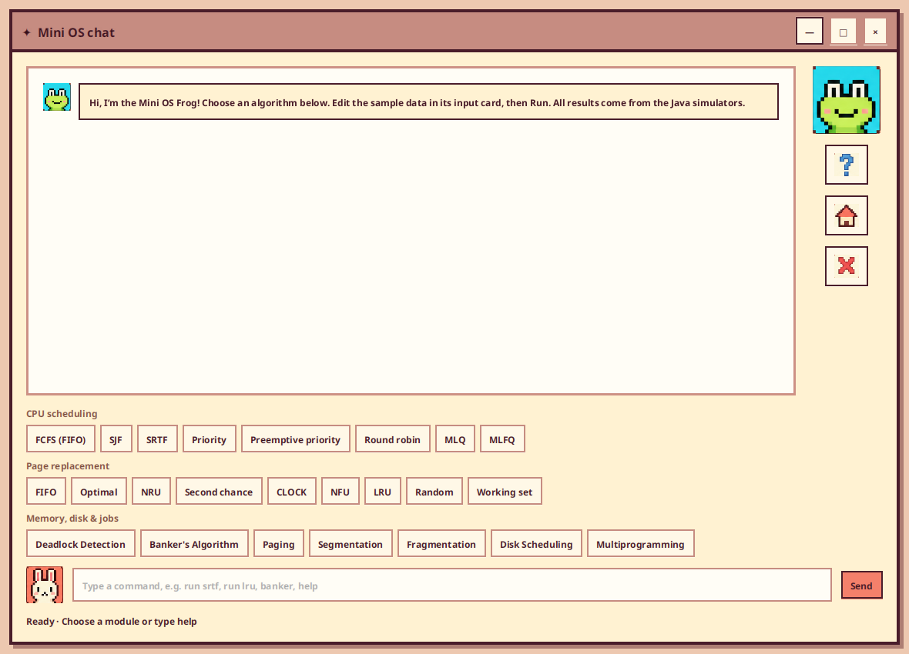

# Mini OS — Java simulator

JavaFX frog/bunny conversation interface plus the original Swing simulator. Includes CPU scheduling, page replacement, Banker's algorithm, deadlock detection, paging, segmentation, fragmentation, disk scheduling and multiprogramming.



## Open in Antigravity (Windows)

Download **Code → Download ZIP**, extract to a new folder, then open the extracted `minions-main` folder in Antigravity. Install JDK 21 and restart the IDE. In its terminal run:

```powershell
java -version
javac -version
cd .\MiniOS-Java\javafx
.\mvnw.cmd test
.\mvnw.cmd javafx:run
```

The included Maven Wrapper downloads Maven and JavaFX automatically on the first run. Choose an algorithm button, edit the input card, then Run simulation. The command `run lru`, for example, runs the page-replacement card's current data (initially the visible Small sample).

[Full JavaFX setup and controls](MiniOS-Java/javafx/README.md) · [Rubric mapping](MiniOS-Java/RUBRIC-COVERAGE.md) · [Original Swing setup](MiniOS-Java/ANTIGRAVITY-SETUP.md)

On macOS/Linux, from `MiniOS-Java/javafx`, use `sh ./mvnw test` then `sh ./mvnw javafx:run`.
